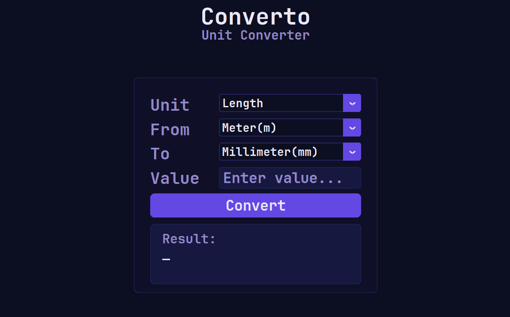
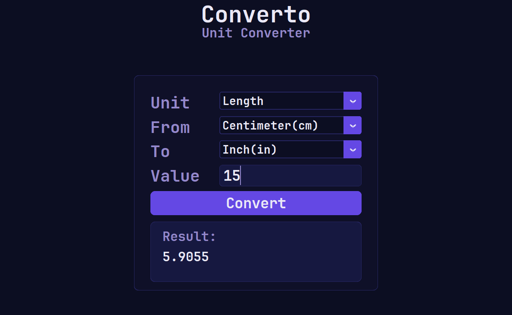
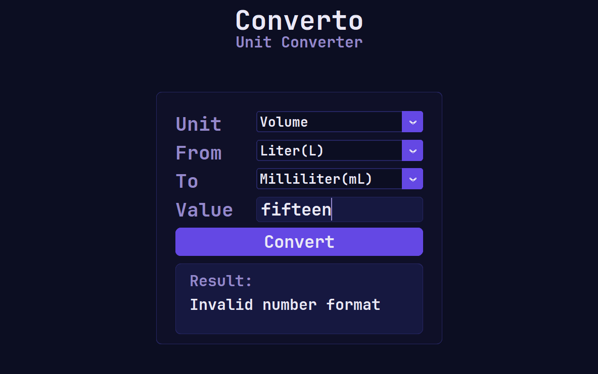

# Converto

A desktop unit converter built with Python and CustomTkinter.



## Features

- Convert units in 11 categories
- Convert currency using rates from Frankfurter
- Use offline conversions for non-currency units
- Select From and To units with dropdowns

## Run from source

Requires Python 3.14 and Windows.

```powershell
python -m pip install -r requirements.txt
python main.py
```

Conversions and settings are not saved locally. Currency amounts are limited to 16 digits. For currency conversions, the entered amount and selected currencies are sent to the Frankfurter API.

## Build the Windows executable

```powershell
python -m pip install -r build-requirements.txt
python -m PyInstaller --clean --noconfirm --onefile --windowed --name Converto --icon icon.ico --add-data "assets;assets" --add-data "icon.ico;." --collect-all customtkinter main.py
```

The executable is created at `dist/Converto.exe`.

## Screenshots






## Licenses

The application source is licensed under the MIT License; see [LICENSE](LICENSE). The bundled JetBrains Mono font is licensed under SIL OFL 1.1; see [assets/OFL.txt](assets/OFL.txt).
